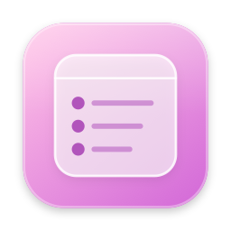
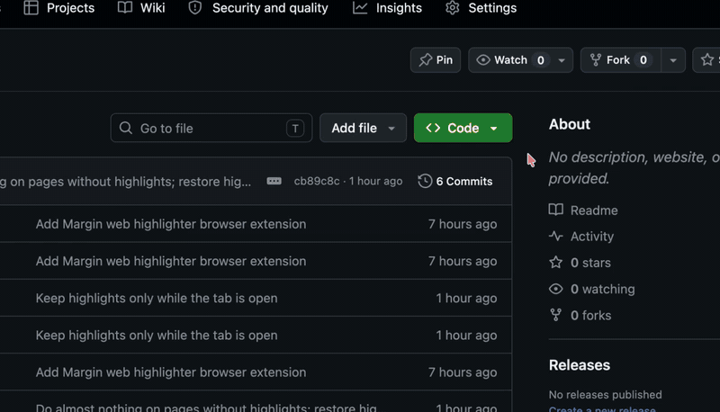

# Jot



**A tiny Mac menu bar app: hold a key, type or talk, and it lands as a bullet in Apple Notes.**



### [⬇️ Download Jot](https://github.com/hi-dad/jot/releases/latest/download/Jot.dmg)
Free · macOS 13 or newer · always the latest version

## Install

1. Open **Jot.dmg** and drag Jot into **Applications**.
2. Open it, and click **Open** when macOS asks if you're sure. (It's signed and checked by Apple.)
3. Allow the permissions it asks for (see below).

## How to use it

- **Hold ⌥ Option** to type a note. **Hold ⌃ Control** to say it.
- Or tap **⌥Space** to type, **⌃Space** to talk. These work even without Input Monitoring.
- Press **Return** to save it as a bullet in your note, or **Esc** to cancel.
- Choose which note it saves to from the **✎** menu bar icon.

## Permissions

- **Input Monitoring:** for the hold-a-key shortcuts. Turn it on, then reopen Jot.
- **Notes:** the first time you save.
- **Microphone** and **Speech Recognition:** the first time you talk.

Use a note just for Jot: it adds to the end of that note. If saving ever fails, your text is copied to the clipboard.

**Updates:** it offers new versions itself (or ✎ menu → **Check for Updates…**). **Remove:** ✎ menu → **Quit Jot**, then drag it to the Trash.

<details><summary>Build it yourself</summary>

Needs Xcode or the Command Line Tools.

```bash
./build.sh        # builds, installs to Applications and opens it
./build.sh dist   # makes dist/Jot.dmg instead
```

Run `./tools/setup-signing.sh` once so permissions survive rebuilds.

</details>

MIT License
